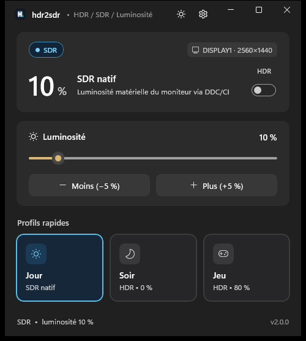

# Hdr2sdr

Application Windows 11 (**WinUI 3 / .NET 10**) pour basculer entre **HDR** et **SDR**, régler la luminosité contextuelle (**luminosité du contenu SDR** en HDR, **luminosité matérielle DDC/CI** en SDR) et appliquer des profils en un clic ou via raccourcis clavier globaux.

Aucun prérequis à installer sur un PC Windows 11 vierge (ni Python, ni runtime .NET, ni Windows App Runtime).



## Installation (PC vierge)

Télécharger et lancer **`hdr2sdr-Setup-2.0.0.exe`** depuis les [Releases GitHub](https://github.com/yoyo1306/hdr2sdr/releases) :

- Installe `hdr2sdr.exe` dans `C:\Program Files\hdr2sdr` (runtime `.NET 10` et `WinUI 3` embarqués).
- Propose les raccourcis Menu Démarrer et Bureau, le lancement automatique au démarrage de Windows (`--tray`) et l’ajout optionnel au `PATH` pour le mode CLI.
- Préserve la configuration utilisateur lors d’une mise à jour et arrête automatiquement toute instance active.
- Désinstallation propre depuis **Paramètres Windows → Applications**.

Les réglages (`config.ini`) sont stockés dans `%LOCALAPPDATA%\hdr2sdr\` lorsqu’installé dans `Program Files` (avec reprise automatique d’une éventuelle ancienne configuration `%APPDATA%\hdr2sdr\config.ini`), ou directement dans le dossier de l’exécutable en mode portable.

## Fonctionnalités

| Fonction | Détail |
|---|---|
| **Bascule HDR / SDR** | Pilotage natif par écran via DisplayConfig (`SET_HDR_STATE` Windows 11 24H2+, repli `SET_ADVANCED_COLOR_STATE` puis `Win+Alt+B`). |
| **Luminosité contextuelle** | En **HDR ON** : règle le curseur Windows *Luminosité du contenu SDR* (`0–100 %`, `80–480 nits`) avec mise à jour DWM instantanée. En **SDR natif** : règle la luminosité matérielle du moniteur via **DDC/CI** (`dxva2.dll`). |
| **Mémoire & synchro écran** | Mémorise la luminosité matérielle SDR avant de passer en HDR, la restaure automatiquement au retour en SDR, et synchronise en arrière-plan les modifications faites aux boutons physiques du moniteur (VCP `0x10`). |
| **3 Profils rapides** | **Jour** (SDR natif), **Soir** (HDR + SDR doux, défaut `0 %`), **Jeu** (HDR + SDR punchy, défaut `80 %`), tous ajustables dans **Options**. |
| **Raccourcis clavier globaux** | 6 raccourcis configurables (`Ctrl+Alt+H`, `Ctrl+Alt+Up/Down` avec répétition maintenue, `Ctrl+Alt+1/2/3`), ré-enregistrés automatiquement au changement d’écran ou en sortie de veille. |
| **Zone de notification & thème** | Icône tray avec infobulle dynamique et menu contextuel, mode **Clair / Sombre** mémorisé, fond **Mica**, instance unique (ramène la fenêtre existante au second lancement). |

## Ligne de commande (CLI) & scripts `helpers/`

Le mode CLI s’exécute directement sans démarrer l’interface WinUI et synchronise automatiquement une éventuelle instance graphique ouverte :

```powershell
hdr2sdr status                    # Affiche l'état HDR/SDR et la luminosité
hdr2sdr toggle | on | off         # Active, désactive ou bascule le HDR
hdr2sdr sdr <0-100|up|down>       # Règle le contenu SDR (HDR) ou DDC/CI (SDR)
hdr2sdr profile jour | soir | jeu # Applique un profil
hdr2sdr --tray                    # Démarre minimisé dans la zone de notification
hdr2sdr version                   # Affiche la version et le chemin de l'exécutable
```

Les 6 scripts silencieux dans `helpers/` (`toggle-hdr.vbs`, `sdr-up.vbs`, `sdr-down.vbs`, `profile-jour.vbs`, `profile-soir.vbs`, `profile-jeu.vbs`) détectent automatiquement `hdr2sdr.exe` (mode portable, `Program Files` ou `PATH`) pour les raccourcis clavier, Stream Deck ou macros.

## Architecture des sources

```text
hdr2sdr\
    src\
        Hdr2Sdr.slnx                solution .NET 10 (x64)
        Hdr2Sdr.Core\               DisplayConfig HDR, SDR white level, DDC/CI + VCP, profils, hotkeys, AppPaths, CLI
        Hdr2Sdr.App\                interface WinUI 3 (Mica, Options intégrées, tray Win32 natif)
    installer\
        hdr2sdr.iss                 script Inno Setup 6 (hdr2sdr-Setup-2.0.0.exe)
    helpers\                        scripts .vbs silencieux (portable / Program Files / PATH)
    build.ps1                       publie en self-contained win-x64 et compile l’installateur
    hdr2sdr.ico                     icône de l’application
    apercu.png                      aperçu de l’interface Windows 11
    legacy\                         archive de la v1.4 WinForms et des anciens helpers
    CHANGELOG.md                    historique des versions
```

## Recompiler

Prérequis de développement : **SDK .NET 10** (`win-x64`) et **Inno Setup 6** (`winget install JRSoftware.InnoSetup`).

```powershell
powershell -ExecutionPolicy Bypass -File .\build.ps1
```

Le script publie `hdr2sdr.exe` (`Release`, `win-x64`, `self-contained`, `WindowsAppSDKSelfContained=true`) dans `publish\`, nettoie les langues satellites inutiles, copie les ressources et génère `dist\hdr2sdr-Setup-2.0.0.exe`.
